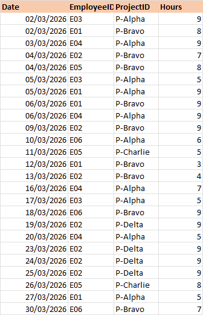
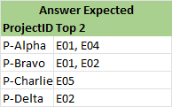

## Excel_Challenge_934 - Top Two
### From Excel BI Challenge account on LinkedIn
###
### Task :Find the top 2 employees for each project IDs who worked the most. If a project has only one employee assigned, list only that employee.

### expected answer

The solution was originally performed in Excel so the python code was copied to an ipynb file

