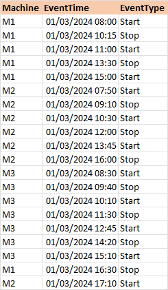
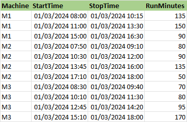

## Excel_Challenge_930 - Start Stop RunTime
### From Excel BI Challenge account on LinkedIn
###
### Task : Create running sessions by pairing Start → next Stop for the same Machine. Also work out the total run time.

### expected answer

For the purpose of using VS Code the initial data was exported to a CSV file.  The solution was originally performed in Excel so the python code was copied to an ipynb file

